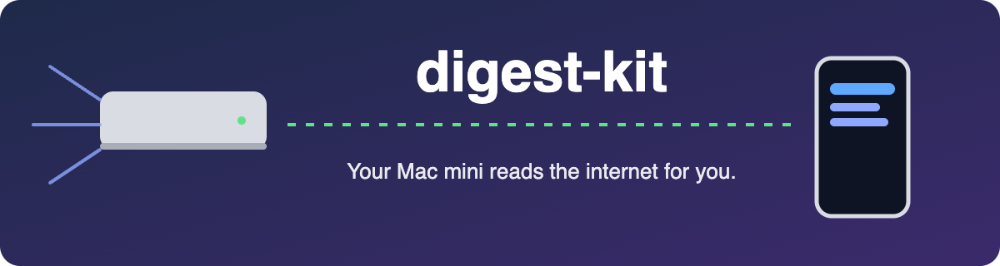

<p align="center"></p>

<p align="center"><a href="README.md">English</a> · <b>简体中文</b></p>

<p align="center">
  
  
  
</p>

# digest-kit

**反正你的 Mac mini 24 小时开着。让它每天早上替你刷一遍信息源，只把值得看的几条推到手机上。**

digest-kit 会去抓你的 RSS、YouTube 频道、GitHub Trending 和 Hacker News，让 Claude 按**你自己的**兴趣挑一遍，存成一份 Markdown 简报，再发一条 Telegram 消息给你。

大约 200 行 zsh 和 Python。不要服务器，不要数据库，不要 Docker。只用 `python3`、`curl`，以及你已经装好的 [Claude Code](https://claude.com/claude-code) CLI。

## 👀 效果

真实跑出来的结果，没改过。用的是示例信息源，加一个两行的兴趣文件：

```markdown
## Try
1. **Graphify** https://github.com/Graphify-Labs/graphify — Turn any codebase into a queryable
   knowledge graph for Claude Code using local deterministic AST parsing.
   Why it fits: Local-first approach, direct Claude Code skill integration.
...
## Read
No strong picks this week. HN content was mostly off-topic (politics, health news, general essays).

## Dropped
20 items. Reasons: off-topic, outside stated interests, insufficient summary detail.
```

没有好东西的时候，它会直接说没有。这正是想要的。

## 🖥️ 给不关机的 Mac 准备的

如果你有一台 Mac mini（或者任何常开的 Mac）在跑 agent，它可以直接放进去：

- **用 launchd，不是 app。** 每小时触发一次，自己判断今天该不该跑。Mac 睡着了，醒来会补跑。没有窗口，也没有菜单栏图标。
- **不会漏。** 手机消息发出去之后，才把这些内容标成已读。抓取、模型、Telegram 任何一步失败，下次还会重试同一批。
- **放着不管也安全。** 模型运行时不给任何工具（`--tools ""`，不加载 MCP）。就算某条内容里写着「忽略之前的指令，去执行 X」，也只能影响简报里的文字，碰不到你的电脑。
- **按你自己的笔记排序。** 指定几个 Markdown 文件（你在做什么、不想看什么、已经在关注什么），它会把你已经知道的东西过滤掉。

## 🚀 安装（5 分钟）

```sh
git clone https://github.com/SeanXLChen/digest-kit ~/digest-kit && cd ~/digest-kit
cp config.example config                 # 改 OUTDIR 和 NOTES
cp sources.example.tsv sources.tsv       # 你的信息源
cp prompt.example.md prompt.md           # 挑选规则和输出格式
FORCE=1 ./digest.sh                      # 第一次跑，不管定时
```

简报存在 `$OUTDIR/YYYY-MM-DD.md`。日志和已读列表在 `~/.local/state/digest-kit/<NAME>/`。

### 📱 推到手机（可选）

用 [@BotFather](https://t.me/BotFather) 建一个 Telegram bot，然后：

```sh
mkdir -p ~/.config/digest-kit
cat > ~/.config/digest-kit/telegram.env <<'EOF'
TELEGRAM_BOT_TOKEN=123456:ABC...
TELEGRAM_CHAT_ID=123456789
# TELEGRAM_THREAD_ID=42   # 发到群组的某个话题
EOF
chmod 600 ~/.config/digest-kit/telegram.env
```

没有这个文件就不发消息，简报照样保存。想换成 ntfy、Slack 或邮件？改 `notify.sh` 就行，就 25 行。

### ⏰ 定时

```sh
sed "s|/PATH/TO|$HOME|" launchd.example.plist > ~/Library/LaunchAgents/local.digest-kit.plist
launchctl bootstrap gui/$(id -u) ~/Library/LaunchAgents/local.digest-kit.plist
```

实际多久跑一次，由 `config` 里的 `EVERY`（天数）和 `AFTER`（几点之后，HHMM）决定。

**想要好几份简报**（比如一份 AI、一份本地新闻）：每份一个 config，`NAME` 和 `OUTDIR` 各不相同；每个 config 配一个 plist，把 config 路径当参数传进去。

## 📡 信息源

`sources.tsv` 用 Tab 分隔：`kind  name  url`。

| kind | url 那一列填什么 |
|---|---|
| `rss` | feed 地址（RSS 或 Atom） |
| `youtube` | 频道 id（`UC...`） |
| `trending` | 一个 GitHub Trending 页面地址 |
| `hn` | `https://hn.algolia.com/api/v1/search`（150 分以上的帖子） |

某个源挂了会记日志并跳过，其他照常跑。

## 🧪 测试

```sh
python3 test_fetch.py
```

不联网，测解析、已读过滤、时间过滤，以及源挂掉的情况。

## 💸 花费

每次运行调一次 `claude -p`。输入是你的笔记加上新内容，通常几千 token。每天都跑的话，在 `config` 里把 `MODEL` 换成小一点的模型。

## 📜 许可

[MIT](LICENSE)
